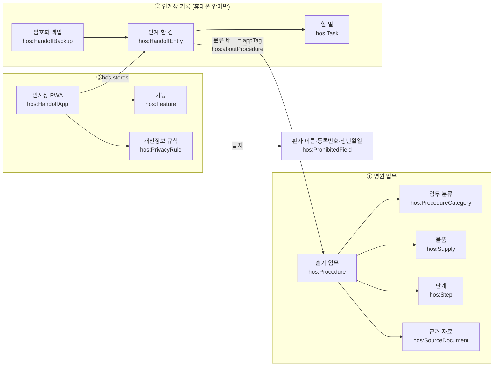

# 의미 지도 (Semantic View)

병원 업무 · 인계장 기록 · 앱을 **같은 이름표(개념)** 로 묶어 둔 지도예요.
같은 개념을 어디서나 같은 이름으로 부르면, 나중에 AI가 기록을 읽거나 새 앱(시뮬레이션 게임 등)을 만들 때 처음부터 다시 설명할 필요가 없어요.

## 1. 세 영역과 연결

## 2. 파일별 역할

| 번호 | 파일 | 담는 것 | 언제 고치나 |
|---|---|---|---|
| 1 | `ontology/handoff.ttl` | 개념과 관계의 정의(OWL) | 새 종류의 정보를 다룰 때 |
| 2 | `ontology/procedures.jsonld` | 술기·업무 이름 목록(SKOS), 근거 자료, 우선순위 | 새 술기·태그를 추가할 때 |
| 3 | `ontology/context.jsonld` | 앱 데이터 칸 ↔ 개념 연결표(JSON-LD) | 앱에 칸을 추가·변경할 때 |
| 4 | `metadata/project.jsonld` | 프로젝트·근거 자료 메타데이터 | 버전·자료가 바뀔 때 |
| 5 | `metadata/decisions.md` | 왜 그렇게 정했는지(결정 기록) | 중요한 결정을 할 때 |
| 6 | `docs/HANDOFF.md` | 지금 어디까지 했고 다음에 뭘 하는지 | 작업을 멈출 때마다 |

## 3. 앱 데이터 칸 ↔ 개념

| 번호 | 앱 칸 | 화면 이름 | 개념 | 비고 |
|---|---|---|---|---|
| 1 | `date` | 날짜 | `hos:handoffDate` | YYYY-MM-DD |
| 2 | `ward` | 병동 | `hos:ward` | |
| 3 | `bed` | 병실·침상 | `hos:bedLocation` | 환자를 구분하는 유일한 방법 |
| 4 | `title` | 요약 | `hos:summary` | |
| 5 | `body` | 내용 | `hos:note` | |
| 6 | `tags` | 분류 | `hos:category` → `hos:aboutProcedure` | `procedures.jsonld`의 `appTag`와 글자가 같으면 술기와 연결 |
| 7 | `todos[].t / done` | 할 일 | `hos:Task` / `hos:taskText` / `hos:isDone` | |
| 8 | `important` | 중요 | `hos:isImportant` | |
| 9 | `createdAt / updatedAt` | 처음 쓴 때 / 고친 때 | `hos:createdAtMs` / `hos:updatedAtMs` | 백업 합치기는 더 나중 것 우선 |
| 10 | (없음) | — | `hos:ProhibitedField` | 환자 이름·등록번호·생년월일·사진 칸은 만들지 않음 |

## 4. AI 레디(AI가 바로 쓸 수 있는) 상태인 이유

| 번호 | 갖춘 것 | 효과 |
|---|---|---|
| 1 | 백업을 풀면 `@context`가 붙은 JSON-LD | 칸 이름만 봐도 뜻을 알 수 있어요 |
| 2 | 술기 이름을 한 목록(SKOS)으로 통일 | "ABGA", "radial ABGA"가 같은 개념으로 묶여요 |
| 3 | 근거 자료(`sourcedFrom`)와 확인 상태(`sourceStatus`) | 어디서 온 지식인지, 아직 확인 안 된 것은 무엇인지 구분돼요 |
| 4 | 금지 항목을 개념으로 명시 | 새 기능을 만들 때도 개인정보 칸이 생기지 않게 막아요 |

※ 실제 인계 기록은 저장소에 절대 넣지 않아요. 저장소에는 **모양(스키마)과 이름표(어휘)** 만 있어요.

## 5. 이 지도로 답할 수 있어야 하는 질문 (확인용)

| 번호 | 질문 | 쓰는 연결 |
|---|---|---|
| 1 | 이번 주 ABGA 관련 할 일 중 안 끝난 것은? | `HandoffEntry → category(ABGA) → Task(isDone=false)` |
| 2 | 시뮬레이션 게임의 C-line culture 단계는 무엇을 근거로 했나? | `Procedure → hasStep`, `sourcedFrom` |
| 3 | 근거 문서를 아직 확인하지 못한 술기는? | `sourceStatus` 가 있는 `Procedure` |
| 4 | ABGA와 dressing이 동시에 오면 무엇부터? | `higherPriorityThan`, `priorityRank` |
| 5 | 이 앱이 지키는 개인정보 규칙은? | `HandoffApp → enforces → PrivacyRule` |
